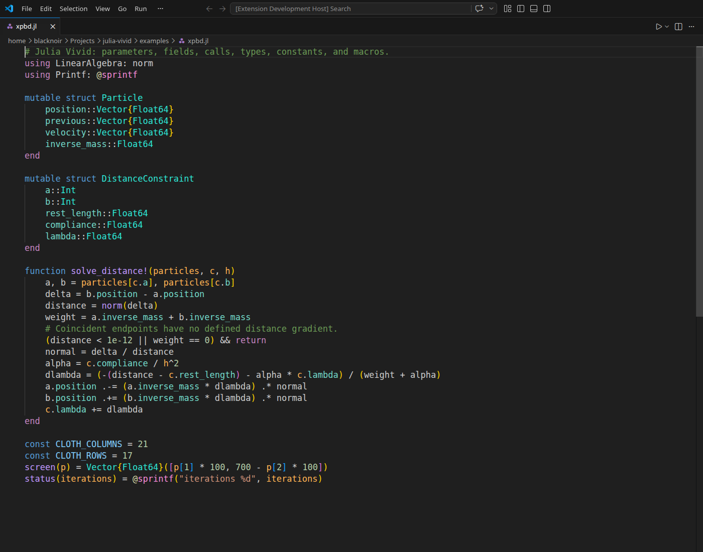

# Julia Vivid

More distinct Julia highlighting in VS Code, using your current color theme.

Julia Vivid colors parameters **orange**, fields **mint**, function calls **purple**,
types and constructors **cyan**, constants **blue**, and macros **pink**. It recognizes
Julia syntax using [Pluto's Lezer Julia parser](https://github.com/JuliaPluto/lezer-julia).
It doesn't need a running Julia process.

## Install

1. Download `julia-vivid-0.1.0.vsix` from [GitHub Releases](https://github.com/andredalbosco/julia-vivid/releases/latest).
2. In VS Code, run **Extensions: Install from VSIX…** and select the file.
3. Open a `.jl` file. The colors apply automatically.

Or run:

```sh
code --install-extension julia-vivid-0.1.0.vsix
```

The official [Julia extension](https://marketplace.visualstudio.com/items?itemName=julialang.language-julia)
is a dependency and supplies the language mode and base syntax grammar. Julia Vivid
adds identifier colors using editor decorations, so it works even when semantic
highlighting is disabled. It does not replace Julia's language server or change your theme.



## Configure

Run **Julia Vivid: Toggle Highlighting** to turn the overlay on or off.
Search settings for `Julia Vivid` to adjust individual colors:

```json
{
  "juliaVivid.enabled": true,
  "juliaVivid.colors.parameter": "#FFB454",
  "juliaVivid.colors.property": "#73DACA",
  "juliaVivid.colors.function": "#C099FF",
  "juliaVivid.colors.type": "#2EE6D6",
  "juliaVivid.colors.constant": "#82CFFF",
  "juliaVivid.colors.macro": "#F78CDA"
}
```

The default palette is designed for dark backgrounds; customize it for light themes.
Comments, literal text, keywords, numbers, and operators keep their existing theme colors.
Code within string interpolation is highlighted. Files over 1,000,000 UTF-16 code
units are skipped by default (`juliaVivid.maxFileSize`).

## What it recognizes

- Parameters and their uses inside long-form functions, short-form functions,
  anonymous arrow functions, and `do` blocks, including typed/default/keyword arguments.
- Fields after a dot and fields declared in structs.
- Function calls, including qualified and broadcast calls.
- Explicit type annotations and type declarations.
- Uppercase constructor calls and uppercase constant names; explicit `const` bindings.
- Macros, without coloring matching names in comments or ordinary string text.

This is **syntax-based highlighting**, not compiler-backed name resolution. Uppercase
callees are treated as constructors by convention. Dynamic calls, imported aliases,
local shadowing in `let`/loop scopes, generated code, and unusual metaprogramming can
be ambiguous. Existing language-server features continue to work independently.

## Development

Requires Node.js 22+ for the packaging tools.

```sh
npm ci
npm test
npm run build
xvfb-run -a npm run test:editor  # Linux editor integration check
npm run package
```

The integration runner uses `/usr/share/code/code` by default; set `VSCODE_EXECUTABLE_PATH`
to test a different local VS Code installation. Tests use an isolated editor profile.

The VSIX bundles the parser and runtime into JavaScript: no native modules, Julia
runtime, network requests, telemetry, or platform-specific build step at activation.
